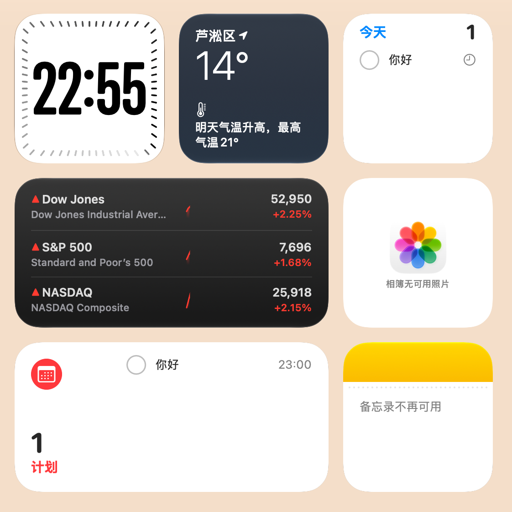

<div align="center">

# MacWidgets

**仿 macOS 桌面小组件 · Windows / WPF / .NET 10**

[](./LICENSE)
[](https://dotnet.microsoft.com/download/dotnet/10.0)
[](https://github.com/shiyu429/MacWidgets/releases/latest)
[](https://github.com/shiyu429/MacWidgets/releases/latest)

在 Windows 桌面上放置仿 macOS 风格的小组件：时钟、天气、提醒事项、股票、照片、备忘录、原神活动日历等。支持拖动吸附、全局缩放、置底桌面层与托盘常驻。

[⬇️ 下载安装包](https://github.com/shiyu429/MacWidgets/releases/latest) · [查看源码](https://github.com/shiyu429/MacWidgets)

</div>

> ⚠️ 本项目在 Linux 上交叉编译完成，**尚未在真实 Windows 上运行测试**。见文末「已知限制与风险」。

---

## 功能

| 组件 | 说明 |
|---|---|
| 时钟 | 窄体粗数字（Impact / Bahnschrift），边缘 60 根刻度沿圆角矩形分布，彗尾式走秒（默认 30fps 平滑流动，可改为每秒跳一格）；12/24 小时制 |
| 天气 | Open-Meteo 免 key 数据；自动定位（ipwho.is + Nominatim 反查区县名）或手动搜索城市；「明天气温升高，最高气温 X°」等提示规则；中号附 4 天预报；°C/°F |
| 提醒事项（小号） | 「今天」列表 + 数量；点圆圈完成（勾选动画，0.6 秒后淡出）；悬停「+」内联新建（回车保存、Esc 取消）；双击标题编辑日期/时间；右键删除；可切换「全部未完成」 |
| 股票 | 默认 上证指数 / 创业板指 / 恒生指数；腾讯 → 新浪（带 Referer）→ 东方财富 三源降级，GBK/GB18030 解码；迷你分时线（按交易分钟固定 X 轴、昨收虚线）；代码列表可编辑并校验；红涨绿跌可切换；中号 3 行 / 大号 7 行 |
| 照片 | 占位为自绘花朵图标；双击/右键/拖入图片添加；图片复制到数据目录；「调整照片」对话框：拖动平移、滚轮/滑块缩放 1–5×、旋转 90°、填充/适应、重置 |
| 提醒事项·计划 | 红色日历图标 + 计划数量；按日期时间列出已安排事项（今天显示 23:00，其他显示「明天 9:00」/「11月6日 9:00」）；新建时必须填写日期时间 |
| 备忘录 | 黄色顶栏 + 点状虚线；双击编辑多行文字，失焦/Esc 结束，500ms 防抖自动保存；粘贴只取纯文本 |

**通用能力**

- 组件库只显示默认尺寸，所有组件使用**全局缩放 75%–200%**；Per-Monitor V2 DPI（`app.manifest`），矢量渲染不糊
- **拖动与吸附**：按住空白处拖动；吸附屏幕边距/中线、其他组件边/中线、16px 等间距；未命中时吸附 16px 网格；品红色参考线；`Alt` 临时关吸附、`Shift` 锁定方向、`Esc` 取消；重叠 >30% 自动移到最近空位
- **一键添加到桌面** / **一键锁定布局**；原生 WM_POINTER 触摸拖动，按钮命中高度至少 44 DIP
- **右键菜单**：编辑小组件、专属操作、锁定位置、移除；DWM Acrylic + 半透明高光玻璃样式
- **桌面层**：默认置底模式（不进任务栏/Alt+Tab、不抢焦点）；可选「嵌入桌面模式（实验）」
- **托盘图标**：显示主界面、锁定布局、重置位置、退出；关闭主界面只是隐藏到托盘
- **记住位置**（按显示器设备名 + 工作区相对逻辑坐标）；开机自启；单实例
- 首次运行按参考图布局自动摆好组件，并创建一条示例提醒；有时间的提醒到点弹出托盘通知

---

## 安装

1. 打开 [Releases 最新版](https://github.com/shiyu429/MacWidgets/releases/latest)
2. 下载 **`MacWidgets-Setup-1.0.23.exe`**
3. 双击安装（按用户安装，无需管理员）
4. 从开始菜单启动 **MacWidgets**，或运行安装目录下的 `MacWidgets.exe`

自包含发布，目标机器无需预装 .NET。

---

## 从源码构建

1. 安装 [.NET 10 SDK](https://dotnet.microsoft.com/download/dotnet/10.0)（x64）。可选：Visual Studio 2026 / Rider，或 VS Code + C# Dev Kit。
2. 克隆后在仓库根目录执行：

```powershell
dotnet build MacWidgets.sln -c Debug
dotnet test tests/MacWidgets.Core.Tests
dotnet run --project src/MacWidgets.App
```

3. 发布自包含单文件：

```powershell
dotnet publish src/MacWidgets.App/MacWidgets.App.csproj -c Release -r win-x64 --self-contained `
  -p:PublishSingleFile=true -p:IncludeNativeLibrariesForSelfExtract=true -p:EnableCompressionInSingleFile=true `
  -o ..\dist\publish
```

或运行 `.\build\publish.ps1`（同时生成 zip；若装了 [NSIS](https://nsis.sourceforge.io/) 还会生成安装包）。

在 Linux/macOS 上交叉编译：项目已设 `EnableWindowsTargeting=true`，执行 `./build/publish.sh`（需要 .NET 10 SDK；安装包需要 `makensis`）。

联网单测（真实接口冒烟）：`MACWIDGETS_LIVE=1 dotnet test tests/MacWidgets.Core.Tests`。

---

## 运行与使用

- 首次启动会在主屏左上角按参考图摆好组件，并打开主界面
- 托盘区有图标：左键打开主界面，右键可添加组件 / 切换编辑模式 / 退出
- 组件上 **右键 → 编辑小组件…** 可修改时钟、天气、股票、照片、提醒、备忘录等设置与位置锁定
- 数据目录：`%AppData%\MacWidgets\`（`layout.json`、`reminders.json`、`cache.json`、`photos\`、`log.txt`）；写入采用临时文件 + 原子替换，并保留 `.bak`

---

## 参考图

布局与视觉对照参考（非运行截图）：



---

## 目录结构

```
├─ MacWidgets.sln
├─ Directory.Build.props
├─ LICENSE / README.md
├─ src/
│  ├─ MacWidgets.Core/          # 与 UI 无关（net10.0，可在任何系统单测）
│  │  ├─ SnapEngine.cs          # 吸附算法
│  │  ├─ ClockGeometry.cs       # 刻度环几何 + 彗尾透明度
│  │  ├─ WeatherText.cs         # 天气提示规则
│  │  ├─ Stocks/                # 代码规范化、三源解析、行情客户端
│  │  └─ Weather/               # Open-Meteo / 城市搜索 / IP 定位
│  └─ MacWidgets.App/           # WPF 应用（net10.0-windows）
│     ├─ App.cs / app.manifest  # 入口、单实例、PerMonitorV2
│     ├─ Interop/ Hosting/      # P/Invoke、拖动吸附、桌面层
│     ├─ Widgets/ Services/     # 组件视图、行情/天气/时钟服务
│     ├─ Data/ UI/              # JSON 持久化、主界面与对话框
│     └─ Assets/
├─ tests/MacWidgets.Core.Tests/ # xUnit：吸附、几何、接口样本解析
├─ build/                       # publish.sh / publish.ps1 / installer.nsi
└─ tools/ref/reference.png      # 布局参考图
```

---

## 与方案 A 的差异（已确认的调整）

1. **打包**：未使用 Velopack；改为自包含单文件 exe + zip + NSIS 安装包（按用户安装，无需管理员）。没有自动更新。
2. **持久化**：只用 JSON（不使用 SQLite），图片复制进数据目录；路径为 `%AppData%`。
3. **Win32 互操作**：手写 `DllImport`，未使用 CsWin32。
4. **依赖精简**：未使用 CommunityToolkit.Mvvm、WPF-UI、H.NotifyIcon、Polly、Serilog、Microsoft.Extensions.*；界面用代码构建（无 XAML），托盘用 WinForms `NotifyIcon`。运行时无任何第三方 NuGet 包。
5. **定位**：未接入 `Windows.Devices.Geolocation`，只用 IP 定位 + 手动城市；不接和风天气。
6. **字体**：不内置字体；中文 `PingFang SC` → `Segoe UI` → `Microsoft YaHei UI`；时钟数字优先 `Impact`。
7. **未做**：拖放弹性动画、照片多图轮播、股票代码联想搜索、Toast（用托盘气泡代替）、深色模式、全屏应用检测时暂停动画。

---

## 已知限制与风险（均未在 Windows 上实测）

- **桌面层 Z 序**：置底 + 前台钩子在 Win+D / Win+M / 任务视图 / 多桌面 / 全屏游戏下的行为需要实测
- **嵌入桌面模式**为实验功能：WPF 透明窗口作为 `WorkerW/Progman` 子窗口在 Win11 24H2+ 上可能不显示或无法点击，默认关闭
- **不抢焦点与输入**：`WS_EX_NOACTIVATE` 窗口需要打字时临时可激活；中文输入法候选框、右键菜单关闭行为需实测
- **多显示器 / 混合 DPI**：跨不同缩放比例屏幕拖动时可能有一两帧跳动
- **Fluent 主题**（`Window.ThemeMode`）为 .NET 实验 API，Win10 上异常会退回经典样式
- **透明分层窗口性能**：时钟 30fps 重绘，预计 CPU 占用很低但未测量
- **数据源**：均为非官方公开接口，可能变更或限流
- **照片**：未处理 EXIF 方向；HEIC 依赖系统 HEIF 扩展
- 单元测试只覆盖 Core；**WPF 界面代码只保证编译通过**，视觉 1:1 程度需在 Windows 上对照参考图微调

---

## 数据来源

腾讯财经 / 新浪财经 / 东方财富（行情与分时，非官方接口，仅供个人参考）；Open-Meteo（天气，免费非商用）；ipwho.is（IP 定位）；OpenStreetMap Nominatim（反向地理编码，© OpenStreetMap contributors）。

---

## License

本项目采用 [MIT License](./LICENSE) 开源。Copyright (c) 2026 shiyu429。
